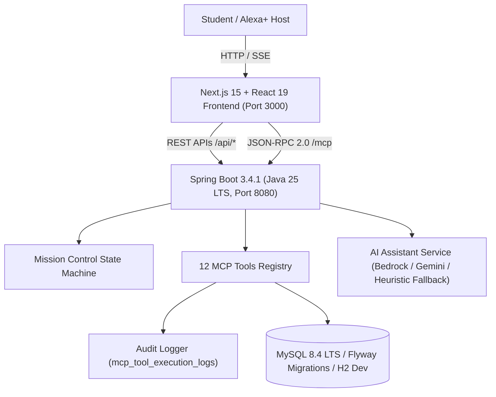

# NEXUS AI — The Intelligent Student Operating System
### Build, Ship, Shape: Amazon Developer Hackathon — Alexa+ Track

> **"Turn ambition into action."**

[](https://www.oracle.com/java/)
[](https://spring.io/projects/spring-boot)
[](https://nextjs.org/)
[](https://tailwindcss.com/)
[](https://modelcontextprotocol.io/)
[](https://www.mysql.com/)
[]()

---

## 🌟 Overview

**NEXUS AI** is an autonomous academic command center built for modern students. Instead of static to-do lists, NEXUS AI provides an interactive **Mission Control** orchestration pipeline that translates high-level natural language academic goals (e.g. *"I have a Java exam on Friday, a database assignment on Thursday, and only two hours available each evening. Help me prepare."*) into conflict-free, day-by-day study sessions and actionable tasks.

Every action is governed by a **human approval safety gate** and executed through standards-compliant **Model Context Protocol (MCP)** tools over Streamable HTTP and SSE, saving real data to a persistent relational database.

---

## 🎨 User Interface & Design System

Inspired by futuristic deep-space productivity dashboards:
- **Base Background:** Obsidian Navy (`#070B17`, `#0A0F1D`)
- **Glassmorphic Cards:** High-contrast layered surfaces (`#10182B`, `#151F35`) with backdrop blur
- **Accents:** Electric Violet (`#8B5CF6`) and Cyan Glow (`#22D3EE`)
- **8 Dedicated Pages:**
  1. **Overview Dashboard (`/` & `/dashboard`):** Holographic glowing orb hero, 4 real-time stat cards, dual Recharts activity curves, interactive task preview, 7-day schedule blocks, embedded assistant, and MCP health widget.
  2. **Mission Control (`/missions` — Flagship):** Multi-step autonomous state machine (`UNDERSTANDING` &rarr; `PLANNING` &rarr; `CHECKING_CONFLICTS` &rarr; `AWAITING_APPROVAL` &rarr; `EXECUTING` &rarr; `COMPLETED`) with conflict detection, visual plan preview, and human approval gate.
  3. **AI Assistant (`/assistant`):** Multi-turn conversational interface with live MCP tool invocation cards, prompt suggestions, and voice command simulation.
  4. **My Tasks (`/tasks`):** Comprehensive CRUD operations, priority filtering (High/Medium/Low), course tags, instant checkbox toggle, search, and edit modal.
  5. **Study Planner (`/planner`):** 7-day calendar timetable with manual block creation and AI study session generator.
  6. **Analytics (`/analytics`):** Real SQL-backed productivity trends, focus hours, completion velocity, and course distribution.
  7. **MCP Activity Monitor (`/mcp` & `/mcp-activity`):** Real-time telemetry, 12 tool health indicators, raw JSON-RPC payload inspection, and an interactive live test console.
  8. **Settings (`/settings`):** Student profile customization, AI provider & key configuration (Bedrock/Gemini/OpenAI/Ollama), MCP server ping test, and database reseed utility.

---

## 🔌 12 Mandatory Model Context Protocol (MCP) Tools

NEXUS AI hosts a standards-compliant Streamable HTTP MCP server on `POST /mcp` and `GET /mcp/sse`:

| Tool Name | Description | Key Parameters |
| :--- | :--- | :--- |
| `create_task` | Create new academic task | `title`, `subject`, `priority`, `dueDate`, `estimatedMinutes` |
| `list_tasks` | Retrieve tasks with status/subject/priority filters | `status`, `subject`, `priority` |
| `update_task` | Update an existing task's attributes | `taskId`, `title`, `subject`, `priority`, `status`, `dueDate` |
| `complete_task` | Mark a task completed | `taskId` |
| `delete_task` | Delete an assignment | `taskId` |
| `get_upcoming_deadlines`| Scans assignments due within N days | `daysAhead` (default: 3) |
| `create_study_session` | Schedule a focused study block | `title`, `subject`, `startTime`, `endTime`, `durationMinutes` |
| `list_study_sessions` | Retrieve scheduled study sessions in date window | `startTime`, `endTime` |
| `reschedule_study_session` | Shift an existing study block | `sessionId`, `newStartTime`, `newEndTime` |
| `detect_schedule_conflicts` | Detect overlapping timetable commitments | `startTime`, `endTime` |
| `generate_study_plan` | Synthesizes day-by-day milestone schedule | `subject`, `examDate`, `dailyHoursAvailable`, `topics` |
| `get_productivity_summary` | Computes live SQL-backed focus hours & progress | none |

---

## 🏗️ Technical Architecture



---

## 🚀 Quickstart Guide

### Prerequisites
- **Node.js:** v20+ (tested on v25.9.0)
- **Java:** JDK 21+ or JDK 25 LTS (tested on Oracle JDK 25.0.4.1)
- **Maven:** 3.9+ (tested on Maven 3.9.16)
- **Docker:** Optional for containerized deployment

---

### Option 1: Standalone Local Mode (Instant Zero-Config Run)

The application includes an embedded in-memory database with Flyway-ready schema, pre-seeded with Alex's academic dataset.

1. **Start the Backend:**
   ```bash
   cd backend
   mvn spring-boot:run
   ```
   *The backend starts at `http://localhost:8080`.*

2. **Start the Frontend:**
   ```bash
   cd frontend
   npm install
   npm run dev
   ```
   *The frontend starts at `http://localhost:3000`.*

3. Open **`http://localhost:3000`** in your browser to experience NEXUS AI!

---

### Option 2: Docker Compose (Full-Stack with MySQL 8.4)

1. Copy the example environment file:
   ```bash
   cp .env.example .env
   ```

2. Build and start the entire stack:
   ```bash
   docker compose up --build
   ```
   *Or:* `docker compose -f compose.yaml up --build`

---

## 🧪 Running Automated Tests

### Backend Unit & Integration Tests (17/17 Passing)
```bash
cd backend
mvn test
```

### Frontend Production Build Verification
```bash
cd frontend
npm run build
```

---

## 📄 Submission Materials Folder

For hackathon judges and evaluators, detailed audit materials are in the `submission/` directory:
- [**DEVPOST_DESCRIPTION.md**](file:///C:/Users/sruja/Desktop/NEXUS-AIpowered-studentCommandSystem/submission/DEVPOST_DESCRIPTION.md) — Comprehensive hackathon entry text.
- [**DEMO_SCRIPT.md**](file:///C:/Users/sruja/Desktop/NEXUS-AIpowered-studentCommandSystem/submission/DEMO_SCRIPT.md) — Exact 3-minute video presentation script with timestamps.
- [**PRODUCT_FEEDBACK.md**](file:///C:/Users/sruja/Desktop/NEXUS-AIpowered-studentCommandSystem/submission/PRODUCT_FEEDBACK.md) — Genuine feedback on MCP protocols, Java 25, and developer tooling.
- [**FRICTION_LOG.md**](file:///C:/Users/sruja/Desktop/NEXUS-AIpowered-studentCommandSystem/submission/FRICTION_LOG.md) — Incident log of technical hurdles and root-cause solutions.
- [**ARCHITECTURE.md**](file:///C:/Users/sruja/Desktop/NEXUS-AIpowered-studentCommandSystem/submission/ARCHITECTURE.md) — Sequence diagrams, ER diagrams, and security architecture.
- [**TEST_REPORT.md**](file:///C:/Users/sruja/Desktop/NEXUS-AIpowered-studentCommandSystem/submission/TEST_REPORT.md) — Full automated test execution and build traces.
- [**SUBMISSION_CHECKLIST.md**](file:///C:/Users/sruja/Desktop/NEXUS-AIpowered-studentCommandSystem/submission/SUBMISSION_CHECKLIST.md) — Line-by-line verification against Amazon Hackathon guidelines.
