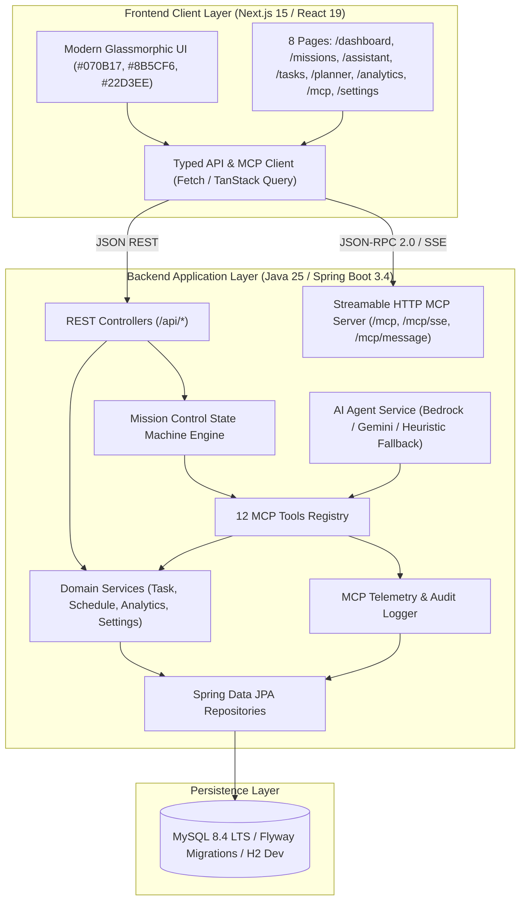
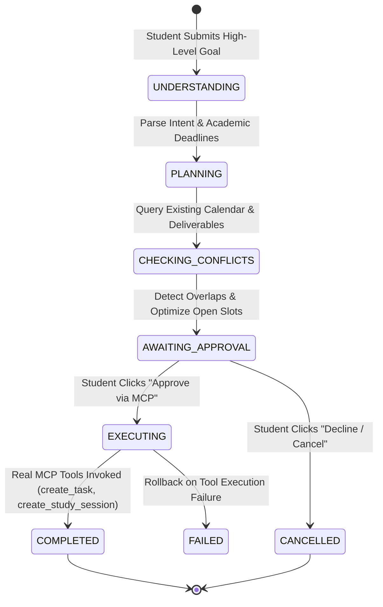
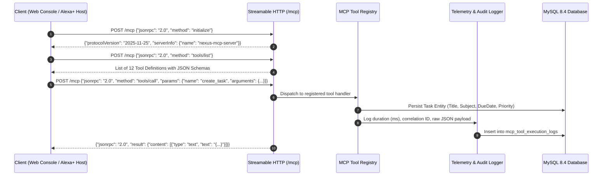
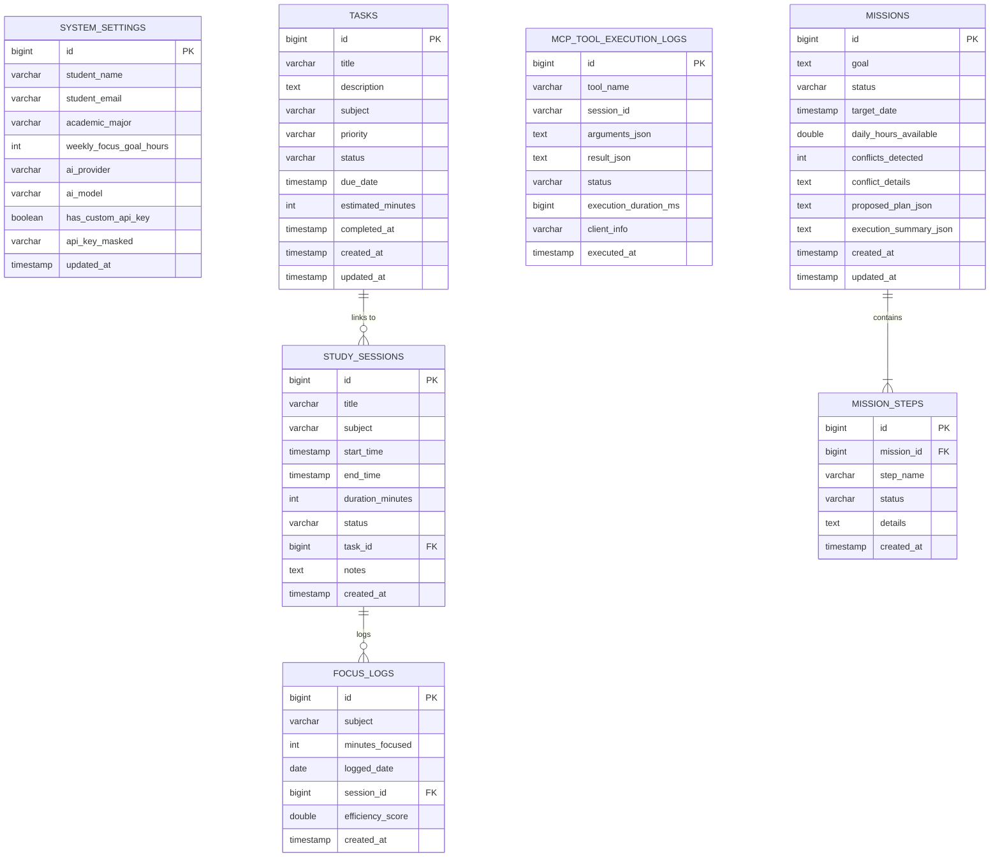

# NEXUS AI — System Architecture & Technical Specification
## Build, Ship, Shape: Amazon Developer Hackathon (Alexa+ Track)

---

### 1. High-Level System Architecture

NEXUS AI is built as a modular 3-tier reactive system:

---

### 2. The Mission Control Flagship Workflow

The core differentiator of NEXUS AI is its stateful, autonomous academic planning pipeline:

---

### 3. Model Context Protocol (MCP) Streamable HTTP Flow

NEXUS AI adheres strictly to the Model Context Protocol (2024-11-05 / 2025-11-25 specifications) via Streamable HTTP and SSE:

---

### 4. Database Schema Entity Relationships

The relational schema is managed through **Flyway migration `V1__init_schema.sql`** and enforced via foreign key constraints:

---

### 5. Security Architecture

1. **Zero Client-Side Secret Exposure:** AI model credentials (`AI_API_KEY`, `GEMINI_API_KEY`, `OPENAI_API_KEY`, `AWS_ACCESS_KEY_ID`) are exclusively held in server-side environment variables or masked in the settings repository. No API key is ever embedded into frontend client bundles.
2. **Safe Local Fallback:** When no external credentials are present, the system defaults to deterministic heuristic execution, preventing credential leakage or runtime crashes.
3. **Audit Trail Immutability:** Every MCP operation records its correlation ID, duration, caller info, and raw input/output payloads in `mcp_tool_execution_logs`.
